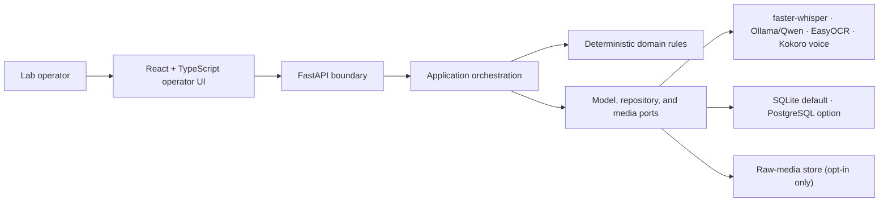
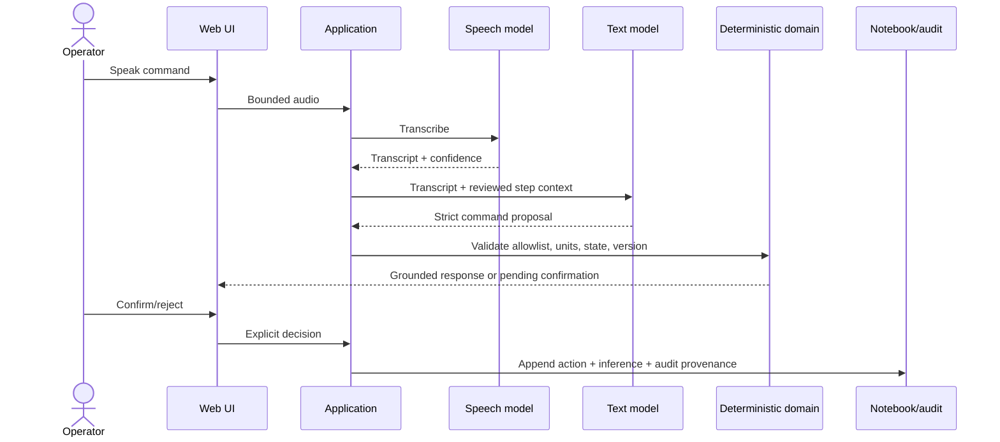
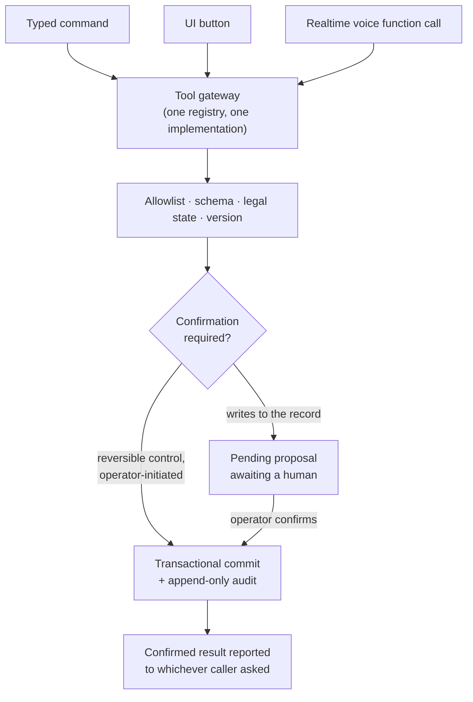
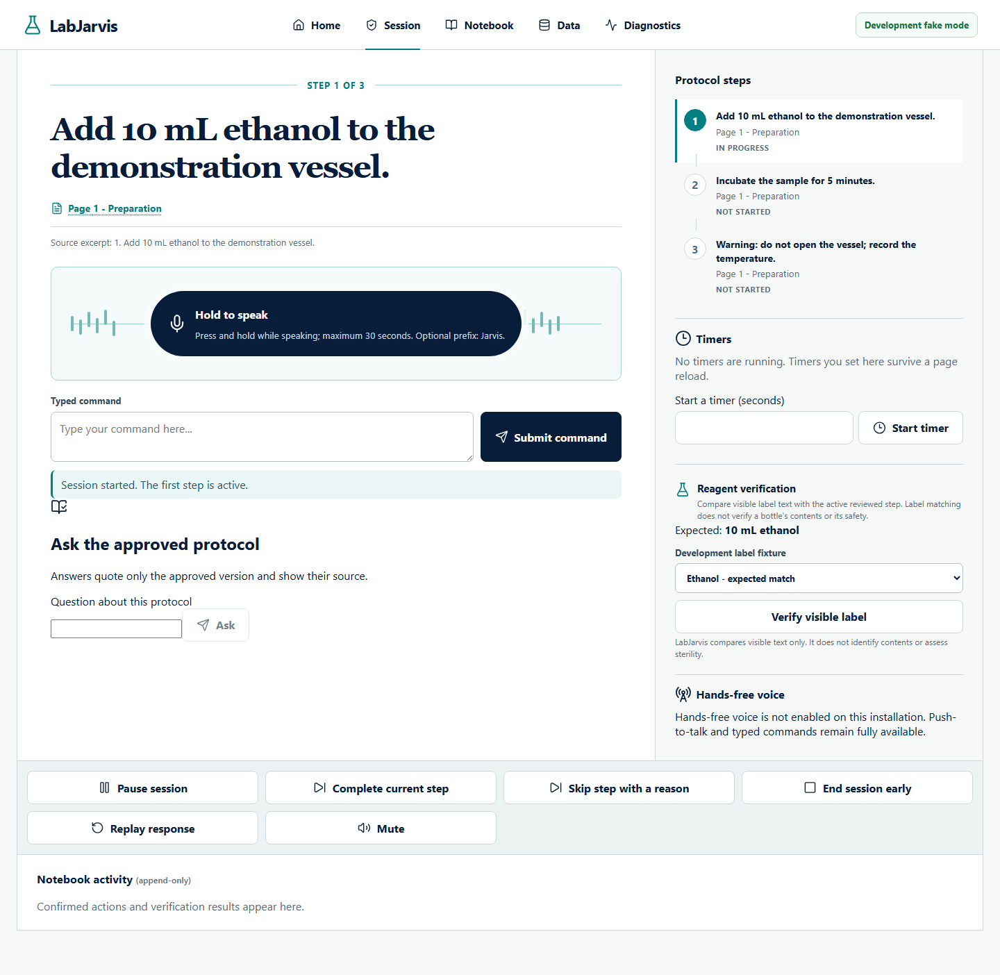
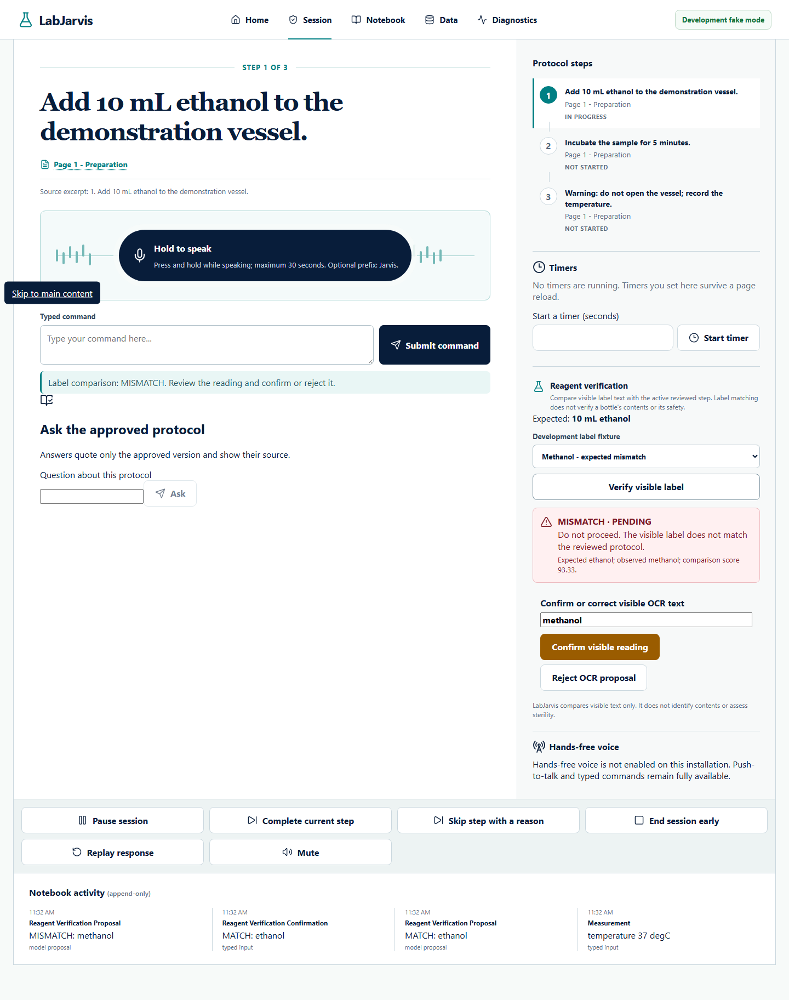
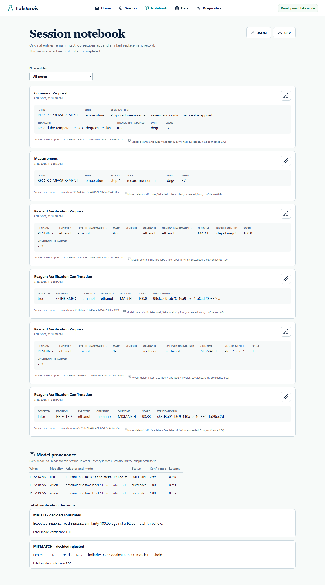

# LabJarvis

I built LabJarvis to help a researcher follow a reviewed laboratory protocol
when touching a keyboard or notebook would interrupt sterile work. It combines
speech recognition, structured language understanding, and label OCR. The
models interpret speech and labels; ordinary code validates the proposed
actions and requires operator confirmation before changing a session.

This is a BSc Computer Science project for **CM3020 Artificial Intelligence, 4.1 Project Idea 1: Orchestrating AI models to achieve a goal**. It is an experimental decision-support system—not a laboratory controller, risk assessment, SDS, supervision substitute, or safety certification tool.

## What works

**Protocols and sessions**

- Import an existing protocol as it is - PDF, DOCX (including Word list numbering and tables), plain text, or Markdown - with no reformatting. Deterministic structuring proposes steps, sub-steps, reagents, timers, and safety notes, keeps the source hash and text, flags anything the document leaves ambiguous (ranges, unclear timings, repetitions, conditions) instead of guessing, and lists every line it did not use as a step. Edit the proposal, tick off each flag, then approve an immutable version; the server refuses approval while a flag is unchecked or placeholder text remains. Approval and session creation commit in one transaction, so a failure can never leave an approved protocol with no session behind it.
- Find and resume work from a dashboard of recent protocols and in-progress sessions. Protocols and sessions are URL-addressable, so a reload, a bookmark, and a shared link all land in the same place.
- Give a run an optional non-identifying label, then filter sessions by label, state, date, text, or exact protocol version. Duplicate runs remain distinguishable by label, short ID, exact start time, state, and progress.
- Copy an approved protocol into a new editable draft, archive/restore obsolete protocols, and reveal archived records only when requested. Historical sessions remain attached to the immutable version that was actually run.
- Import image-only PDFs through an explicit, bounded OCR option. OCR-derived source text is marked as such and goes through the same operator review and approval as ordinary extraction.
- **An active session survives a browser reload and a backend restart.** The client rebuilds its entire view from a server snapshot rather than from memory.

**Running a session**

- Typed commands, push-to-talk (the on-screen button **or a configurable key anywhere on the page, so a USB foot pedal works**), optional in-browser hands-free listening with a required wake phrase, or the optional hosted realtime voice — all resolving to the same allowlisted actions with the same rules.
- **Hands-free sterile step:** a measurement can be dictated and then confirmed by saying the value back ("confirm 10 millilitres"); "what is the next step" is answered aloud; "check reagent" opens the camera and speaks the result. Local Vision offers live scan (default) or one timed frame, chosen before gloving up and remembered in this browser; hosted Vision captures one cropped frame after a spoken countdown. An automated browser journey exercises the local live-scan path with only the pedal key and voice (`apps/web/e2e/hands-free.spec.ts`).
- **Voice-only (no pedal), opt-in:** with `LABJARVIS_VOICE_ONLY_CONFIRMATION_ENABLED`, the wake-phrase listener can also answer a proposal - but only with a value-bearing reply that starts with the wake phrase and restates the content ("Jarvis, confirm 10 millilitres", "Jarvis, confirm 10 minutes", "Jarvis, confirm step 3", "Jarvis, confirm skip step 2", "Jarvis, confirm cancel 10 minute timer", "Jarvis, confirm start session", "Jarvis, confirm ethanol"). A bare "yes", a wrong or second value, another action, speech without the wake phrase, an echo of LabJarvis' own read-back, or a stale proposal never commits; a mismatching or uncertain label can only be rejected.

**Hands-free and eyes-free bench workflow** (**Settings -> Hands-free mode**, or `LABJARVIS_HANDS_FREE_PROFILE=true`; [ADR 0018](docs/architecture/decisions/0018-hands-free-bench-workflow.md))

*Definitions.* **Hands-free:** no manual input to the computer between opening the session and ending it (holding a bottle to the camera is lab work, not computer operation). **Eyes-free:** every outcome you need is spoken; the screen shows the same, never exclusively. Protocol import, review and approval stay on screen on purpose - they happen before gloving up. **Touch budget:** one tap at session start in a normal browser (browsers require a gesture before audio); zero with the kiosk launch.

- One switch turns on listening, autostart, voice-only confirmation, the speech cross-check (`base.en`), model warm-up and timer alarms. Vision on this computer offers live scan or timed one-frame capture; hosted Vision sends one requested frame after a spoken countdown. Startup is refused with any missing required local model named, and Diagnostics shows one **Hands-free: ready** line.
- Opening a session shows **Tap once to start hands-free** (it also asks for microphone and camera permission). Listening then stays on for the whole session, recovers from a microphone failure by itself (3 retries), and can be controlled by voice: "stop listening" / "start listening", "mute" / "unmute", "say that again", "stop" (interrupts speech), "stop the alarm".
- By voice: start or resume the session; ask the protocol ("Step 2 says: ..." or "I couldn't find that in the approved protocol"); what reagents do I need, where am I, what did I just record, how long is left; set, pause, resume and cancel timers (LabJarvis asks which when unclear); spoken and sounded timer alarms, repeated until acknowledged and surviving a reload; check a reagent by name, alias or number with the configured Vision capture; skip a step with a reason; correct the last (or a named) measurement - the original entry is kept and linked; complete steps and end the session. Observations can be confirmed voice-only only if `LABJARVIS_VOICE_OBSERVATIONS_ENABLED` is set (weaker: "confirm observation" after a read-back, accepted only when both transcriptions agreed).
- `python scripts/tasks.py hands-free` is the kiosk launch: the profile plus Chrome/Edge in app mode with the autoplay flag on `http://127.0.0.1` only, with a kiosk banner on screen and a fallback to the one-tap prompt if the flag is not honoured.

**Evidence so far.** The automated Playwright run completed a protocol with
one tap and 35 wake-phrase utterances, and with no tap in kiosk mode
(`apps/web/e2e/zero-touch.spec.ts`). In synthetic speech tests using two TTS
voices and real local models (Whisper small.en + base.en, grammar +
qwen2.5:3b, EasyOCR), the 112 reply clips produced 0 false commits. Once
understood, 13/13 valid replies committed and 13/13 rejections were recorded;
78/78 bare, wrong, second-value, unaddressed, and echoed replies were refused.
Commands were understood in 104/112 clips. Protocol questions produced the
right step for 8/10 answerable cases and abstained for 8/8 unanswerable ones.
The run also answered 26/26 read-only queries and controls, silenced 4/4
alarms by voice, and completed two scripted protocols (28 steps) with 0 and 1
on-screen fallbacks, 2 and 3 re-asks, and durations of 28-37 s. The
[hands-free evidence](research/final_report_evidence/hands-free/) separates
those scripted and synthetic results.

I also completed one eight-step session with my own voice on 2026-09-28 using
hosted speech. There were 0 unintended commits: 18 proposals, 15 accepted and
3 rejected. The app answered 10/10 read-only questions correctly and silenced
the timer alarm by voice. It refused 22 of 60 utterances (37%) because the two
transcriptions disagreed, mainly over number words versus digits (fixed during
the session) and accent spellings (mitigated afterwards, not yet tried with
real speech). I document the build changes and limits in the
[real session record](research/final_report_evidence/real-world/). I still
need a false-wake run and a real-voice run with local models.
- **Live label scan, opt-in:** with `LABJARVIS_LIVE_LABEL_SCAN_ENABLED`, "check reagent" probes the camera with *local* OCR under the `stable-asymmetric-v3` rule, then submits the selected frames as an ordinary pending reading. Probes are never recorded, stability authorises nothing, and the mode is refused when the vision stage is hosted.
- Direct controls (pause, resume, complete step, skip with a reason, timers, end session) call typed application endpoints. **They do not pass through a language model**: a button already states its intent, so involving one would add latency and a failure mode without adding safety.
- **Timers are durable.** Remaining time is derived from a stored deadline, so a timer keeps running across a reload, a restart, or a laptop lid closing, and a timer that elapsed while nothing was listening settles correctly on the next read.
- Confirmation is required before anything is written to the experimental record, and the dialog shows the **normalised** value and unit that will be stored.
- Skip-with-reason and early termination produce honest summaries that distinguish steps performed from steps never performed.

**Grounded answers**

- Current step, next step, expected reagents, progress, the last entry and active timers are answered from structured approved state — no model involved — on screen and by voice.
- Open protocol questions are answered by deterministic retrieval over the approved version, quoting the passage with its page, section, and step. When the protocol does not address the question it **says so** instead of producing a plausible number. Questions can be typed into the **Ask the approved protocol** panel or asked by voice; a language model may only route a spoken question, never write the answer.

**Reagent verification**

- Capture a label, extract the visible text, and classify `MATCH`, `MISMATCH`, or `UNCERTAIN` deterministically, with the operator confirming, rejecting, or correcting it.
- Steps with **no** reagent requirement show no verification panel; steps with **several** require you to say which reagent you are holding, so a match for one is never recorded against another.

**Speech integrity (optional, off by default)**

- When `LABJARVIS_HIGH_INTEGRITY_TRANSCRIPTION_ENABLED` is set, utterances that could change the record get a second reading; when the two disagree about a number, unit, or negation, **nothing is recorded** and the operator is asked to repeat. The 5 mL / 50 mL case is covered end to end. In synthetic speech tests it caught nothing (the primary made no entity errors) and asked for a repeat on 11% (base.en verifier) to 20% (tiny.en) of correct utterances. In one later real-voice session, transcription disagreement led to 22/60 refused utterances; that session changed configuration during the run and cannot measure the feature's effect in isolation.

**Text understanding**

- A **deterministic-first cascade**: a fixed grammar handles the phrasings it knows (and has produced 0 unsafe executions); every other phrasing goes to a language model whose output must match an **intent-discriminated schema** (each intent allows exactly its own fields; no model-reported confidence) and whose numbers, units, durations and observation wording must actually appear in the utterance. Optional agreement mode and an optional second verifier model can veto a proposal.
- On 98 supported **human-written** held-out utterances (public CLINC150, CookDial and Wizard-of-Tasks text), the grammar alone gets 2; the default local cascade (qwen2.5:3b) gets 89, with 96 of 98 routed to the model. See [the model-selection record](docs/evaluation/model-selection-record.md) — including why no configuration met every predeclared criterion.

**Operational honesty**

- Readiness reports each model stage separately — configured, dependency installed, model downloaded, loaded, provider reachable — so "not ready" tells you which prerequisite is missing rather than leaving you guessing.
- A 503 from the readiness probe is reported as *a model is not usable yet*, never as *the API is unreachable*. They need completely different responses.
- Runs end to end with deterministic fake adapters in CI, with three local pre-trained model adapters (verified through the production service: `python scripts/tasks.py smoke-local`), with hosted providers, or with any per-stage mixture (for example local Whisper and EasyOCR with a hosted OpenAI-compatible text model). The UI and readiness endpoint state, per stage, the model and whether it runs locally or is hosted — and by whom.
- A local data-management screen provides complete session export, consistent SQLite backup packages, staged restore validation, and integrity-aware typed deletion. It also states which exports, backups, synchronized copies, and hosted-provider records are outside a local delete.

## Architecture



The dependency direction is `UI/API → application → domain/ports`; vendor and database adapters implement ports from the outside. See the [architecture overview](docs/architecture/overview.md) for C4, sequence, state, data, and deployment diagrams.

### Model orchestration



The model never writes to the database or advances the protocol directly.

### One gateway for every caller

Typed commands, UI buttons, and realtime voice function calls all resolve against
a single tool registry and execute through one application method. There is no
second path, which is what stops a confirmation requirement quietly not applying
to one of them.



The registry is published at `GET /api/v1/tools`, so the frontend reads the
policy rather than restating it. The realtime layer receives a strict subset of
it. See [ADR 0011](docs/architecture/decisions/0011-deterministic-core-realtime-shell.md).

### Optional realtime voice (hosted, OpenAI)

The realtime voice mode is **off by default** and the entire product works without it;
the push-to-talk, pedal and wake-phrase paths above are local and need no provider.
When enabled, the browser receives a short-lived credential minted server-side
and already scoped to one model, one voice, and the tool allowlist — the account
key never leaves the backend. Reconnecting reloads authoritative state rather
than replaying whatever was in flight, and tool calls carry an idempotency key so
a redelivered call reports what already happened instead of doing it twice.

Enabling it requires naming the model explicitly (`LABJARVIS_REALTIME_MODEL_NAME`);
no default is assumed, because provider aliases move and a recorded result is only
reproducible if the exact identifier that produced it was stored.

**The voice model can propose a measurement. It cannot approve one.** There is no
confirmation tool on the realtime surface, so there is nothing it could call to
commit its own proposal. What commits one is a separate microphone recording,
captured only after the assistant has demonstrably finished speaking, submitted
to a dedicated endpoint that refuses audio already used in the session, reads it
through the high-integrity transcription path, and classifies it in ordinary
code. Recording cannot start while the assistant may still be audible - otherwise
its own readback, which names the value, could reach the microphone through the
loudspeaker. For the whole of that cycle the outgoing microphone track is
detached from the voice service, so it cannot hear the operator's confirmation
and answer it by itself; if the track cannot be detached, or the browser cannot
positively measure that the speaker has gone quiet, spoken confirmation is
refused and the on-screen control is used instead. This is verified by
deterministic tests only — **live acoustic behaviour on speaker-equipped
hardware remains unverified**.

For a measurement a bare "yes" is refused: the operator has to say the value back
— *"confirm ten millilitres"* — and the restated number and unit are compared
against the proposal. Saying yes proves someone replied; saying the number proves
they heard the same number that is about to be written down. The on-screen confirm
and reject controls remain available throughout, and anything ambiguous leaves the
proposal open rather than resolving it.

A dropped connection is rebuilt rather than announced: the dead peer is torn down,
authoritative state is re-read, a new short-lived grant is minted, and a new peer
is created, with bounded attempts. The status says *listening* only once a working
connection exists, and after the attempts are exhausted it says so and points at
push-to-talk.

**The realtime WebRTC audio path has not been run against a live provider.**
Automated tests use fixture audio and a stubbed transport. The
[spoken-confirmation decision](docs/architecture/decisions/0014-spoken-confirmation-requires-fresh-human-audio.md)
records the remaining acoustic checks.

## Working application

These screenshots are regenerated by `python scripts/tasks.py screenshots` from an isolated running fake-mode API/UI using only the visibly labelled synthetic development protocol. They are implementation evidence, not real-model or participant evidence.

| Reviewed sterile workflow | Conservative label warning |
|---|---|
|  |  |



## Quick start: deterministic fake mode

Prerequisites: Python 3.12, Node.js 22.13 or newer, pnpm 11.9.0 (via Corepack), and Chromium for browser tests (`pnpm --dir apps/web exec playwright install chromium`). Docker and model downloads are not required.

```powershell
python scripts/tasks.py setup
.venv/Scripts/python scripts/generate_sample_data.py
python scripts/tasks.py demo
```

Open <http://127.0.0.1:5173>. Choose **Load development sample**, review and approve it, then start a session. Fake fixtures are visibly labelled and are development evidence only.

On macOS/Linux, replace `.venv/Scripts/python` with `.venv/bin/python`. `make setup`, `make demo`, and the other Makefile targets delegate to the same cross-platform Python runner.

## Local real-model mode

| Domain | Local adapter | Default | Purpose |
|---|---|---|---|
| Audio | faster-whisper | `small.en`, CPU `int8` (GPU `float16` verified) | speech-to-text |
| Text | rule grammar + Ollama | cascade with `qwen2.5:3b` (provisional; see the record) | intent-discriminated command proposal |
| Image | EasyOCR | `english_g2`, CPU (GPU verified) | visible label OCR |

Measured warm p95 on the project laptop (RTX 4050): Whisper 0.39 s GPU / 1.99 s
CPU, EasyOCR 0.16 s GPU / 1.31 s CPU, cascade LLM route 0.3 s (GPU via Ollama).
GPU setup and its one pitfall (two CUDA stacks in one process) are in
[docs/models/gpu-setup.md](docs/models/gpu-setup.md). Inputs for these numbers
were synthetic; real-media measurements are pending.

Install [Ollama](https://ollama.com/download), then explicitly obtain optional dependencies and weights (Whisper, EasyOCR, the Ollama text model and the Kokoro voice):

```powershell
python scripts/tasks.py models
.venv/Scripts/python scripts/setup_models.py check
python scripts/tasks.py dev
```

Then open **Settings**, choose **Local** (or **Custom** for GPU), **Save configuration** and press **Restart LabJarvis** (see [Settings](#choosing-the-configuration-in-the-app-settings)).

Normal startup never downloads weights (`ollama pull qwen2.5:3b` for the default text model, about 1.9 GB). Set `LABJARVIS_WARM_MODELS_ON_STARTUP=true` to load the models in the background after startup; readiness shows each stage as warming/ready/failed and the API never waits for it. Read the [model guide](docs/models/README.md) before using real mode.

### Optional hosted models (OpenAI and any OpenAI-compatible provider)

Hosted execution is **provider-neutral**: each stage (speech, text, vision) has
its own provider — `local`, `openai`, `deepseek` (text only, with its own key,
endpoint and options) or the generic `openai_compatible` (GLM/Z.ai, a
self-hosted gateway, ...) — with its own model identifier and declared
capabilities; see the commented examples in [`.env.example`](.env.example). An OpenAI-compatible text
endpoint is used through `/chat/completions` with strict JSON schema, JSON mode
or prompt-only output depending on what it supports, and **every answer is
validated against the same schema either way**. Vision or speech on a
compatible endpoint must be declared explicitly, because chat compatibility does
not imply either. Reasoning models take a configurable reasoning effort
(`LABJARVIS_HOSTED_TEXT_REASONING_EFFORT`, e.g. `none` for gpt-5.4-nano or
gpt-5.6-luna). The cascade's optional verifier model may run on its own provider
(`LABJARVIS_TEXT_VERIFIER_PROVIDER`). An OpenAI-compatible server on
`localhost`/`127.0.0.1` (vLLM, llama.cpp, LM Studio) is shown and recorded as
**local**. Live-tested on 2026-09-27: DeepSeek text, GLM text and vision, OpenAI text,
transcription and vision, and an OpenAI realtime grant mint. A post-hoc
comparison (D6/D7, $1.45 of a $2 cap in total) found `gpt-5.4-nano` with
reasoning `none` in the rules-first cascade to be the best OpenAI text option
(89/98 held-out, 0 unsafe); `gpt-5.6-terra` matched it at ~10x the price and
`gpt-5.6-luna` trailed. Hosted vision-language models are *not* recommended for
label checking: on rendered decoy labels they "corrected" misspellings to the
expected reagent (see the model-selection record).

Fully hosted OpenAI is the **Hosted** profile in Settings (the combination
verified end to end on 2026-09-27). **Hosted processing sends audio, transcript
context, and label images to that provider**, so it is off by default and needs
**Allow hosted processing** plus a restart. The label-reading stage is safer
left local (see above). Put the key in `.env` at the repository root, then
choose the profile in Settings:

```text
LABJARVIS_OPENAI_API_KEY=<from your secret store; never commit this>
LABJARVIS_DEEPSEEK_API_KEY=<only if you use DeepSeek>
```

Without the Settings page (containers, CI, scripts) the same configuration can
be given entirely as `LABJARVIS_*` variables; see `.env.example`.

Model identifiers are required and have no defaults, so the exact model behind
any recorded result stays reproducible. The key is read from `.env` or the
environment only — it is never accepted through the browser, stored in the
database or `settings.json`, or returned by any API response. There is no automatic fallback between local and
hosted in either direction. See
[ADR 0016](docs/architecture/decisions/0016-per-stage-provider-neutral-hosting.md)
and [privacy and retention](docs/operations/privacy-retention.md).

### Choosing the configuration in the app (Settings)

Instead of exporting variables, open **Settings** in the navigation bar and pick
one of four profiles:

| Profile | Speech | Text | Vision |
|---|---|---|---|
| **Local** | `small.en` on this computer | `qwen2.5:3b` cascade on this computer | EasyOCR `english_g2` on this computer |
| **Hosted** | OpenAI `gpt-4o-mini-transcribe` | OpenAI `gpt-5.4-nano` (reasoning `none`) | OpenAI `gpt-5.4-nano` |
| **Hybrid** | `small.en` on this computer | OpenAI `gpt-5.4-nano` (reasoning `none`) | EasyOCR on this computer |
| **Custom** | local or OpenAI, CPU or GPU | local (Ollama), OpenAI or DeepSeek | local or OpenAI, CPU or GPU |

OpenAI and DeepSeek are separate providers that can both be configured at once,
each with its own key (`LABJARVIS_OPENAI_API_KEY` or `LABJARVIS_HOSTED_API_KEY`;
`LABJARVIS_DEEPSEEK_API_KEY`), endpoint and request options (see `.env.example`).
Choosing OpenAI in Settings always uses OpenAI's endpoint and key, and DeepSeek
always DeepSeek's; the page remembers each provider's model while you switch.
Put the keys in `.env` so a Restart from Settings picks up a newly added key.

The presets are the same schema Custom edits. In **Custom**, each stage has
*Runs on* (this computer, OpenAI, or an OpenAI-compatible endpoint when one is
configured in the environment), *Model*, *CPU/GPU* for local speech and vision,
and *Reasoning effort* for a hosted text model. The page also holds hands-free
mode, high-integrity transcription, **Allow hosted processing** (off until you
turn it on; any hosted stage is refused without it), credential *status*, and
this browser's push-to-talk / foot-pedal key.

**Save configuration** validates the whole choice with the same rules LabJarvis
uses at startup and lists every problem (hosted processing not allowed, missing
API key, GPU on a hosted stage, missing hands-free
models, ...); nothing is corrected silently and nothing invalid is saved. A valid
choice is written to `<data dir>/settings.json` (choices only: never a key, URL
or path) and the page then shows either **Configuration active** or
**Configuration saved — restart required**. Models are never swapped in a
running process; the ones running now keep working until LabJarvis restarts.

**Restart LabJarvis** appears when LabJarvis was started with
`python scripts/tasks.py dev` (or `hands-free`): that launcher supervises the
API, and the button asks it to stop the API gracefully and start the same
command again, which loads the saved configuration through the normal startup
path. The page reconnects by itself and then shows the new configuration as
active. During an active laboratory session it first asks for confirmation;
protocols, sessions, pending proposals, timers and the notebook live in the
database and survive, but text typed and not yet submitted does not. If
LabJarvis was started any other way (plain `uvicorn`, the container), the page
says *restart it manually* instead of offering a button. The restart request is
accepted only from this computer and carries nothing but that confirmation.

**Where configuration lives.** API keys (`LABJARVIS_OPENAI_API_KEY`,
`LABJARVIS_DEEPSEEK_API_KEY`) and any deliberate advanced override go in `.env`
at the repository root; everything the Settings page offers is chosen there;
`.env.example` is only the reference; anything unset uses the built-in default.
Nothing LabJarvis-specific needs to be in the Windows or shell environment.

**Precedence is resolved per variable**, highest first: a variable in the
environment of the process that starts LabJarvis, the saved Settings choice, the
same variable in `.env`, the built-in default. `.env` is re-read on every start,
so editing a key there and pressing **Restart** in Settings uses the new key;
Settings also re-reads it to show credential status before a restart. The one
thing that can defeat that is the *same* variable exported in the shell that ran
`tasks.py dev`: the launcher passes its environment to every restart, so it would
keep winning. That is never silent: the launcher prints a warning at startup, and
Settings shows where each key comes from (*from .env* or *from an environment
variable, overrides .env*) and lists configuration warnings - a shadowing
environment variable, both `LABJARVIS_OPENAI_API_KEY` and the older
`LABJARVIS_HOSTED_API_KEY` set, or `.env` lines for settings the page manages
(which have no effect once you have saved). Settings also lists any saved choice
an environment variable overrides, rather than implying it is active.
`tasks.py demo` ignores the saved file (`LABJARVIS_IGNORE_SAVED_SETTINGS=true`)
so the demo always uses the deterministic fixtures. If a saved configuration
becomes invalid (for example its key was removed), startup stops with the reason
instead of silently running something else; fix the environment or delete
`settings.json`. Why changes apply only at startup:
[ADR 0019](docs/architecture/decisions/0019-in-app-configuration-applied-at-startup.md).

### Voice output (Kokoro)

LabJarvis speaks its replies with **Kokoro**, a local neural voice (Kokoro-82M,
Apache-2.0, run by the LabJarvis server through ONNX Runtime on the CPU). It is
the recommended choice in **Settings -> Voice output**, with a voice picker and
a *Play sample* button. Nothing is sent anywhere and there is no hosted API. The
browser's own voice stays available as an explicit choice and is used
automatically for any reply Kokoro cannot speak (not installed, failed, audio
blocked). Install it once:

```powershell
python scripts/setup_models.py kokoro
```

This downloads two files (about 350 MB, size and SHA-256 verified) to
`.labjarvis/models/kokoro`; `python scripts/tasks.py models` includes it. On the
project laptop a one-sentence reply is ready in about 0.7 s and longer replies
start after their first sentence. Why Kokoro, and the measurements:
[ADR 0020](docs/architecture/decisions/0020-local-neural-voice-output.md).

## Database schema

Alembic owns the schema outright. The API **does not create tables at startup**
and refuses to serve a database that is not at the current revision, naming the
command that fixes it. It used to run `metadata.create_all()` on every start,
which against a database stamped at an older revision created current tables
ahead of the migrations that own them and left it unable to migrate at all.
`tasks.py dev`, `tasks.py demo`, the E2E runner, and the container entry point
all migrate before serving. Schema creation without Alembic survives only as an
explicit, non-environment-configurable argument used by isolated tests.

## Main commands

| Command | Purpose |
|---|---|
| `python scripts/tasks.py setup` | create `.venv`, install pinned dev/runtime packages and frontend dependencies |
| `python scripts/tasks.py migrate` | bring the database to the current revision — **required before the API will start** |
| `python scripts/tasks.py demo` | migrate and run API (`127.0.0.1:8000`) + UI (`127.0.0.1:5173`) with the deterministic fakes (ignores saved Settings) |
| `python scripts/tasks.py dev` | the same, using the Settings choices, `.env` and defaults; supervises the API so **Restart LabJarvis** works |
| `python scripts/tasks.py hands-free` | `dev` with the hands-free profile, plus a Chrome/Edge kiosk window on localhost |
| `python scripts/tasks.py test` | backend tests, research-tooling tests and frontend tests (E2E is separate: `e2e`) |
| `python scripts/tasks.py lint` | Ruff (API, scripts, research) and ESLint |
| `python scripts/tasks.py typecheck` | mypy strict and TypeScript (app and E2E) |
| `python scripts/tasks.py e2e` | isolated fake API/UI plus Playwright journeys |
| `python scripts/tasks.py build` | production frontend bundle |
| `python scripts/tasks.py screenshots` | regenerate actual synthetic-data UI screenshots |
| `python scripts/tasks.py evaluate` | synthetic development evaluation; never a model benchmark |
| `python scripts/tasks.py evaluate-safety` | deterministic safety-property gate; **exits nonzero when a case fails** |
| `python scripts/tasks.py security` | secret scan, `pip-audit`, `pnpm audit` |
| `python scripts/tasks.py models` | explicitly install optional model dependencies and download weights (Whisper, EasyOCR, Kokoro, `ollama pull`) |
| `python scripts/tasks.py test-models` | opt-in real-model smoke tests |
| `python scripts/tasks.py test-hosted-smoke` | opt-in **paid** live hosted provider smoke test; never in CI |
| `python scripts/tasks.py test-realtime-smoke` | opt-in **paid** live realtime grant smoke test; never in CI |
| `python scripts/tasks.py lock` | regenerate the four `apps/api/requirements*.lock` files with pip-tools |
| `python scripts/tasks.py clean` | delete local data (`.labjarvis`), build output and generated evaluation results — destructive |

`docker compose up --build` provides a loopback-only fake-mode deployment (Settings is read-only there: the container API is reached through nginx, not from loopback, so saving and restarting are refused). Add `-f docker-compose.postgres.yml` and set `POSTGRES_PASSWORD` for the PostgreSQL profile. See [local deployment](docs/operations/local-deployment.md).

## Privacy, security, and limitations

- Raw audio and images are discarded by default. Retention is an explicit setting; transcript retention is separately configurable.
- Requests and inference are bounded by size, page, archive, timeout, and concurrency limits. CORS and trusted hosts default to loopback.
- Normal logs omit bodies, transcripts, protocol content, and observed labels. Correlation IDs connect safe operational logs to structured audit records.
- OCR verifies visible text similarity only. It cannot establish contents, concentration, contamination, expiry, container integrity, or chemical safety.
- Speech/OCR/LLM errors remain possible. A matching label is not authorization to proceed.
- State-changing requests from an origin LabJarvis does not serve are refused before routing. CORS governs what a page may read; this governs what it may change. Requests with no `Origin` header are still accepted so local command-line use works, which is sound only because the supported deployment is loopback-only and single-operator.
- Broader real-speech and photograph evaluations, live realtime voice sessions,
  manual accessibility review, participant testing, ethics approval, and the
  narrated project video remain to be completed. The
  [real-session record](research/final_report_evidence/real-world/session-2026-09-28-saline.md)
  explains what the single developer-operated run can and cannot establish.

## Evidence status

Results in this repository come from different kinds of evidence; they are never pooled.

| Class | What it covers | Where |
|---|---|---|
| Fake / fixture | all software verification (tests, E2E, screenshots) | `apps/*/tests`, `apps/web/e2e` |
| Synthetic | authored 81-command benchmark, TTS speech, rendered labels, simulated frame bursts, wake-phrase clips | `research/data`, `research/final_report_evidence/{speech,hands-free,devices}` |
| Public human-written text | held-out paraphrase sets A and B; grounding test protocols | `research/data/heldout`, `research/grounding` |
| Real models on synthetic inputs | local three-model chain through the production service; GPU/CPU latency | `research/final_report_evidence/{real-chain,devices}` |
| Live hosted (paid) | smoke suite and hosted comparators, with a cost ledger | `research/final_report_evidence/live` |
| Real media | One session with the developer's own voice and a handwritten label; broader collection pending | `research/final_report_evidence/real-world`, `research/real_media` |
| Human study | **none yet** — study mode and analysis ready | `research/study` |
| Unverified | live realtime audio sessions; NVDA/manual accessibility; foot-pedal hardware | `docs/architecture/decisions/0014-spoken-confirmation-requires-fresh-human-audio.md`, `docs/accessibility-checklist.md` |

See the [threat model](docs/security/threat-model.md), [responsible-AI boundaries](docs/security/responsible-ai.md), and [security policy](SECURITY.md).

## Testing and evaluation

I keep software checks separate from model evaluation. Pytest, Hypothesis,
Vitest/Testing Library, Playwright, axe, migrations, builds, typing, and
dependency checks test the implementation. The
[evaluation harness](evaluation/README.md) writes hashed per-sample JSON and
CSV for WER/CER, intent and slot scores, unsupported commands, reagent
outcomes, latency, and process RSS. Its included development datasets are
synthetic and do not support real-world performance claims.

The text interpreter was selected by a predeclared protocol over 24 configurations (local, hosted, cascades) on the authored benchmark and two held-out sets of human-written text: [protocol](docs/evaluation/model-selection-protocol.md), [record](docs/evaluation/model-selection-record.md). The stateful property suite drives the real service through 1,000 generated operation sequences with no invariant violation. Report-ready tables and figures are regenerated from raw results in [`research/final_report_evidence`](research/final_report_evidence/INDEX.md).

| Command | What it runs |
|---|---|
| `python scripts/tasks.py ci` | every deterministic gate (lint, types, all tests, build, E2E, secret scan) |
| `python scripts/tasks.py readiness` | the same on a fresh copy of the working tree, writing a local result under ignored `output/readiness/` |
| `python scripts/tasks.py smoke-local` | real local models through the production service |
| `python scripts/tasks.py smoke-hosted` | **paid** hosted smoke, capped by the spend ledger |

## Documentation map

- [Documentation index](docs/README.md)
- [Architecture and ADRs](docs/architecture/overview.md)
- [User guide](docs/user-guide.md)
- [Developer setup and troubleshooting](docs/development/setup.md)
- [API guide](docs/development/api.md)
- [Test strategy](docs/development/testing.md)
- [Models](docs/models/README.md) and [GPU setup](docs/models/gpu-setup.md)
- [Evaluation guide](evaluation/README.md) and [model-selection record](docs/evaluation/model-selection-record.md)
- [Measured evidence and readiness](research/final_report_evidence/INDEX.md)
- [Real-voice session and limitations](research/final_report_evidence/real-world/session-2026-09-28-saline.md)
- [Accessibility checklist](docs/accessibility-checklist.md)

## Licence and acknowledgements

LabJarvis source is released under the [MIT License](LICENSE). Pre-trained models and runtimes retain their own licences: faster-whisper/converted Whisper weights (MIT), Qwen2.5 1.5B/3B Instruct (Apache-2.0 / Qwen Research licence for 3B — check before redistribution), Silero VAD via @ricky0123/vad-web (MIT/ISC), EasyOCR (Apache-2.0), Kokoro-82M (Apache-2.0) via kokoro-onnx (MIT) — whose pronunciation layer, phonemizer and the bundled eSpeak NG, is **GPL-3.0** and is installed only with the optional models extra — and their transitive components. Verify immutable model identifiers and licence terms again when recording final benchmark evidence; no model weights are redistributed here.
