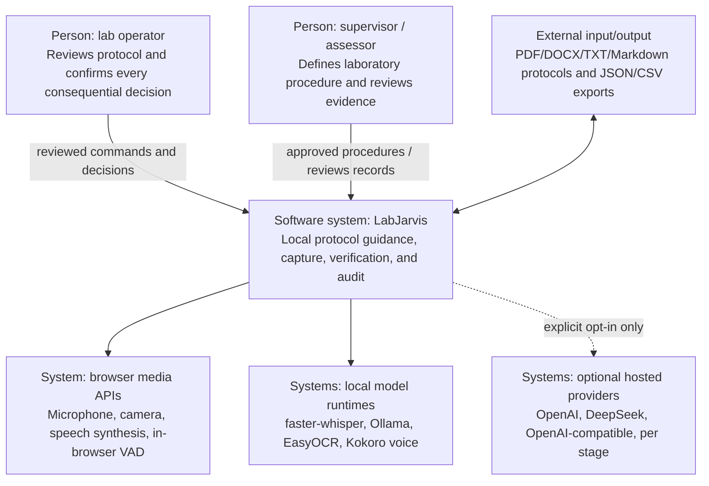
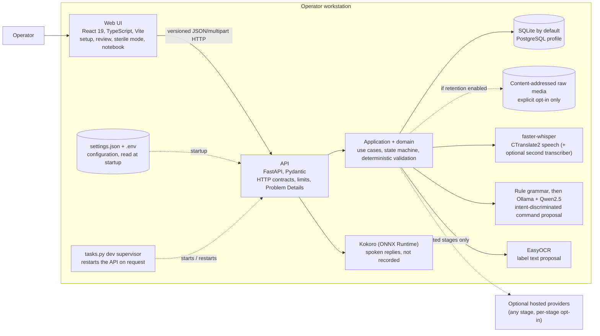
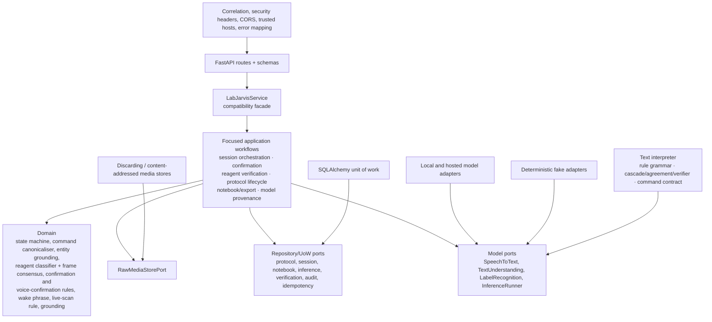
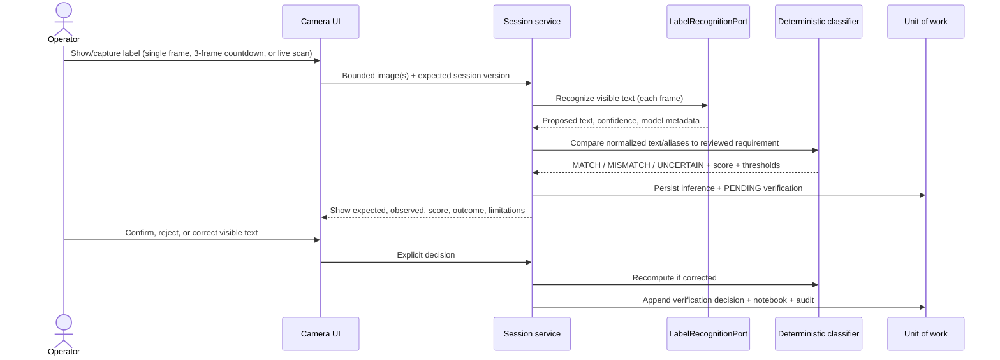
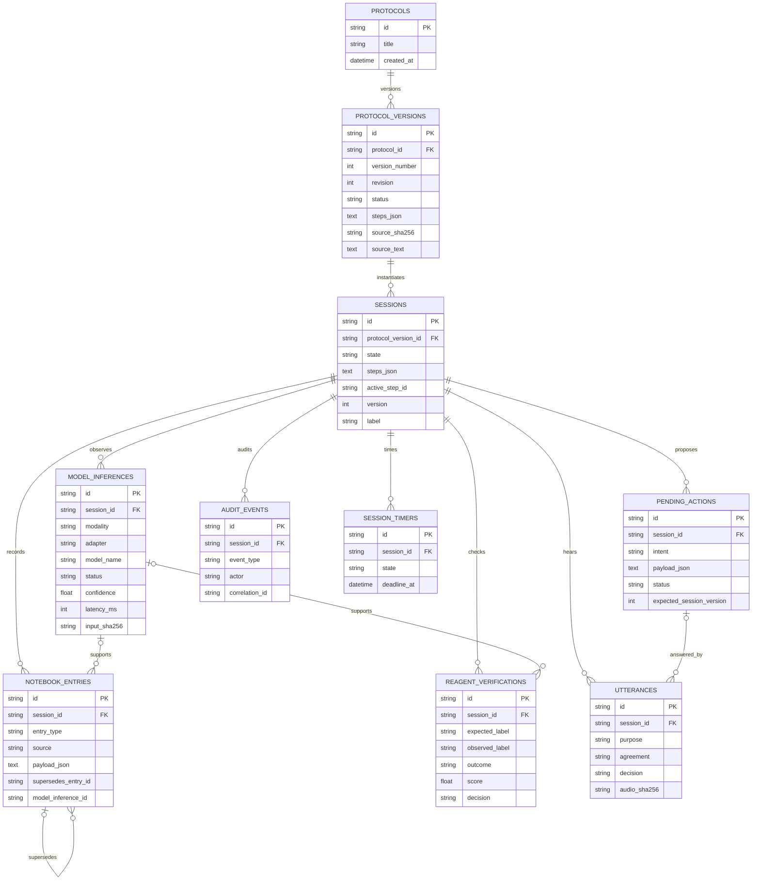
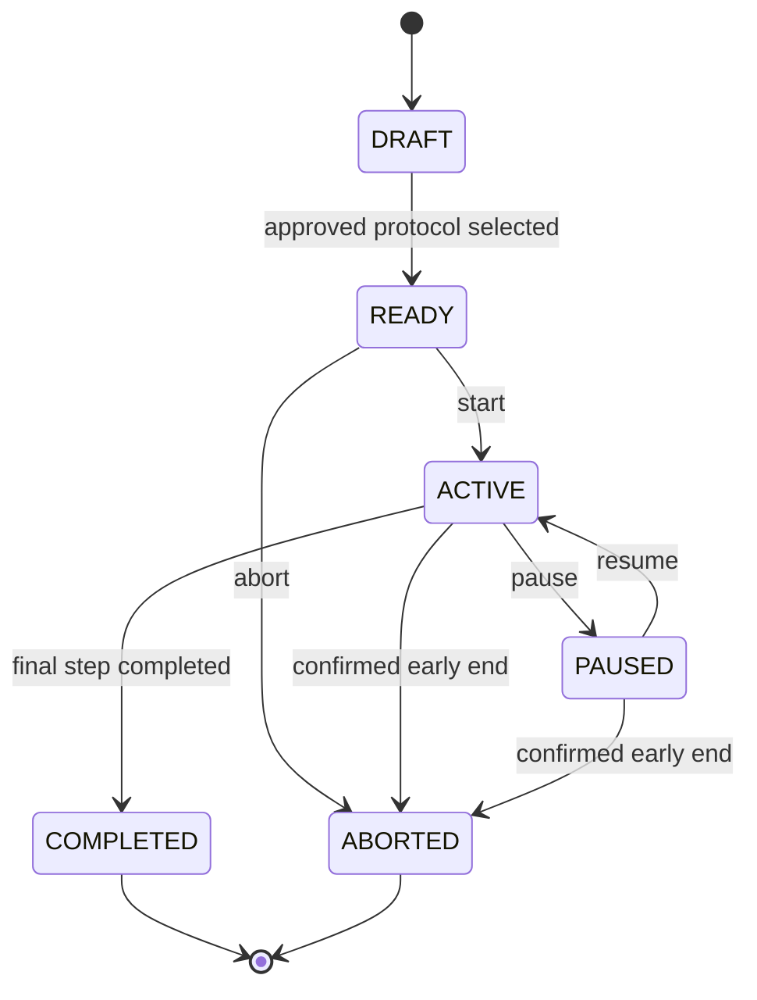
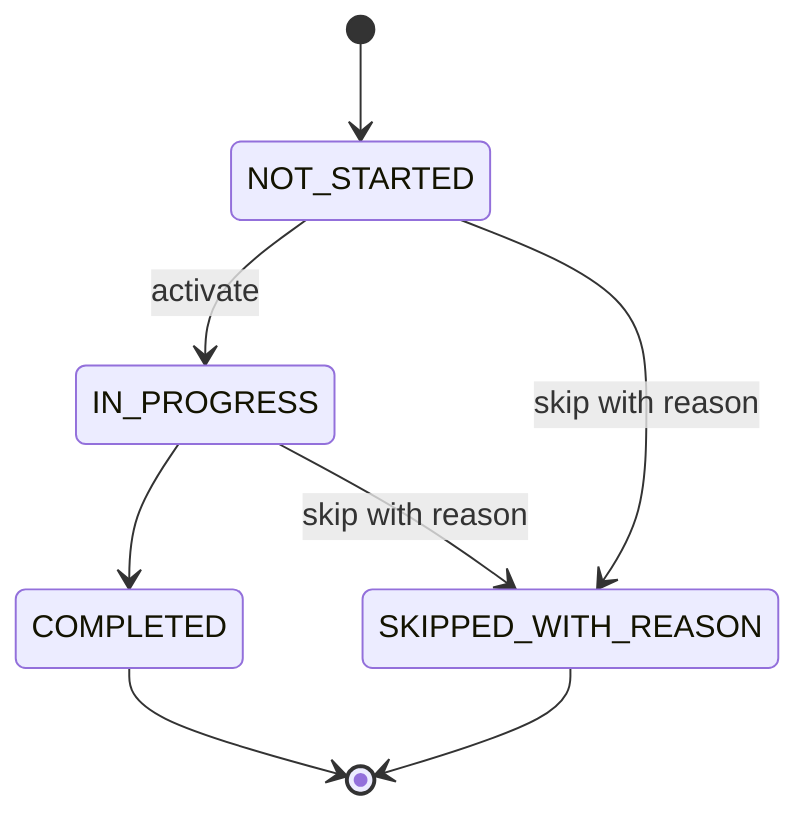
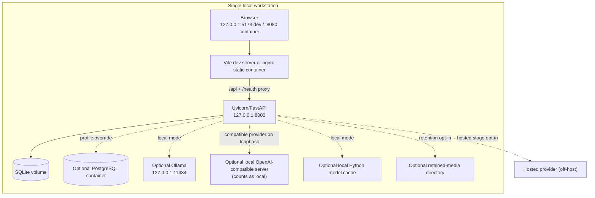

# Architecture overview

## Architectural intent

LabJarvis uses AI only at unstructured perception/interpretation boundaries. The application service orchestrates use cases; framework-free domain code owns legal transitions, canonical command values, label comparison, and append-only provenance. Model proposals cannot call repositories. Consequential actions and OCR readings remain pending until an operator resolves them.

The pragmatic dependency rule is:

```text
React / FastAPI → application use cases → domain + ports
SQLAlchemy / model vendors / file storage → port implementations
```

The API is process-local and synchronous at the use-case boundary. Potentially blocking extraction and inference are dispatched from async routes to a thread pool, then passed through a bounded inference runner with a timeout and semaphore.

## C4 level 1: system context



No third-party cloud service is part of the default context. Each model stage
can be switched to a hosted provider independently
([ADR 0016](decisions/0016-per-stage-provider-neutral-hosting.md)).
Spoken output is the same grounded visible message, voiced by the local Kokoro
model on the server or, as a fallback, the browser's own speech synthesis
(ADR 0020).

## C4 level 2: containers



In fake mode, deterministic in-process adapters replace all three model
runtimes. `infrastructure/model_factory.py` is the only place that knows which
provider runs each stage; the web interface and application use cases do not
branch on vendor. A loopback OpenAI-compatible server counts as local.

## Configuration and restart

Model and execution choices are made on the Settings page, validated by the
same `Settings` rules as any other source, saved to `<data dir>/settings.json`
and applied only at startup; nothing is hot-swapped in a running process
([ADR 0019](decisions/0019-in-app-configuration-applied-at-startup.md)).
Precedence is per variable: process environment, saved choice, `.env`,
default. Keys and endpoint URLs come only from `.env`/the environment, and
`Settings.connection_for` keeps each named provider on its own endpoint and key.
**Restart LabJarvis** is one narrow action: the loopback-only endpoint writes a
token-bearing marker for the `tasks.py dev` supervisor and stops the API along
the graceful Ctrl+C path; the supervisor restarts only its fixed command.

## C4 level 3: API components



`LabJarvisService` remains the stable API-facing facade while focused application
services own session discovery/restoration, confirmation resolution, reagent
verification, protocol lifecycle, notebook/export, and provenance workflows.
Slow OCR runs outside a database transaction; the workflow then reopens a unit
of work and revalidates the active session, step, requirement, version, and
idempotency record before committing. Domain types import no web, database, or
model libraries. Infrastructure may depend on domain/ports, never the reverse.

## Protocol import sequence

```mermaid
sequenceDiagram
    actor U as Operator
    participant UI as React UI
    participant API as FastAPI route
    participant P as Bounded parser
    participant S as Application service
    participant DB as Unit of work

    U->>UI: Choose PDF/DOCX/TXT/Markdown; explicitly opt into OCR for a scan
    UI->>API: Multipart upload
    API->>API: Stream to byte limit; verify media type
    API->>P: Extract in worker thread
    P->>P: PDF page/time/OCR limit or DOCX archive/path/size checks
    P-->>S: Source text, SHA-256, step proposals
    S->>DB: Store protocol + editable draft version
    DB-->>UI: Draft with source references
    U->>UI: Edit/reorder/add/remove steps and requirements
    UI->>S: Update with expected revision
    S->>DB: Optimistic revision update
    U->>S: Approve reviewed revision
    S->>DB: Mark immutable approved version
```

Extraction is deterministic in the current scope. Protocol text is data, never executable instructions to a model or the application.

## Voice command sequence

```mermaid
sequenceDiagram
    actor U as Operator
    participant UI as Sterile-mode UI
    participant API as Session route
    participant STT as SpeechToTextPort
    participant NLU as TextUnderstandingPort
    participant D as Domain validation
    participant DB as Unit of work

    U->>UI: Push-to-talk (button, key or pedal) or wake-phrase segment
    UI->>API: Audio + session version + idempotency key
    API->>STT: Bounded inference
    STT-->>API: Transcript, confidence, runtime metadata
    API->>NLU: Transcript + active reviewed instruction
    NLU-->>API: Grammar match or grounded model proposal (or abstention)
    API->>D: Canonicalize and validate intent/slots/state
    alt Read-only grounded request
        D-->>UI: Exact reviewed current/next instruction
    else Consequential command
        API->>DB: Persist inference + pending action
        API-->>UI: Confirmation proposal
        U->>UI: Confirm or reject
        UI->>API: Resolve pending action
        API->>D: Recheck expected session version
        API->>DB: Append notebook + audit; update state atomically
        API-->>UI: Visible and spoken grounded result
    else Low confidence, ambiguity, invalid output, or timeout
        API->>DB: Append safe inference/audit failure metadata
        API-->>UI: Non-mutating recovery guidance
    end
```

Push-to-talk works from the on-screen button or a configurable key anywhere on
the page (a foot pedal can emulate it); capture is bounded to 30 seconds. With
hands-free listening enabled, an in-browser VAD sends each speech segment with
`require_wake_phrase`, and the server discards any segment not starting with the
wake phrase before interpretation or retention. A proposal is answered through
`/pending-actions/{id}/confirm` (screen) or `/spoken-confirmation` (a fresh
recording, read by the high-integrity transcriber; measurements need the value
read back). In voice-only mode a wake-phrase reply must restate the value being
confirmed ([ADR 0017](decisions/0017-hands-free-listening-and-voice-only-confirmation.md)).

## Reagent verification sequence



With several frames the outcome is the unanimous consensus (`unanimous-v1`):
any disagreement or unreadable frame becomes `UNCERTAIN`. Live scanning probes
frames through `/reagent-scans/probe` without recording anything until the
stability rule holds, then submits the stable frames as above. A `MATCH` means
only that visible OCR text met the configured comparison threshold. It does not
establish what is inside the bottle; a confirmed non-matching reading is
recorded as `not_matching`, never as a completed review.

## Logical data model

Steps and protocol requirements are immutable value objects serialized in reviewed version/session snapshots. Other evidence has its own append-oriented table.



The authoritative schema is `infrastructure/db/schema.py` plus the Alembic
revisions `0001`-`0009` in `apps/api/migrations/versions`; the diagram shows the
main fields only.

Protocol rows also carry an optional archive timestamp. Backup manifests and
content-free deletion receipts live outside session aggregates: a session can
be deleted without deleting the receipt that proves the operation occurred,
and deleting active data does not silently rewrite older backups.

Idempotency records use `(scope, key)` as a composite primary key and retain a request hash plus serialized response. Corrections append a new notebook row whose `supersedes_entry_id` points at the previous entry.

## Session state machine



## Step state machine



Only one step may be active. Pending operator actions and reagent-label reviews are
orthogonal records rather than step states. Completing the active step activates the next
reviewed step, or completes the session. Optimistic versions prevent a stale confirmation
from applying after another state change. Historical `AWAITING_*` values are migrated and
read as `IN_PROGRESS` without changing their associated pending records.

## Local deployment



Compose publishes only to `127.0.0.1`. The system has no authentication because non-loopback/multi-user deployment is outside the implemented security boundary.

## Cross-cutting controls

- **Boundary validation:** strict Pydantic schemas, allowlisted intents, canonical Decimal/unit handling, content/type/page/archive/character limits.
- **Consistency:** SQLAlchemy unit of work, foreign keys, optimistic versions, idempotency keys, immutable approved protocol versions.
- **Model containment:** input hashes, strict structured output, timeout, concurrency bound, confidence/ambiguity gates, no direct persistence.
- **Privacy:** raw media discarded by default; transcript retention independent; normal logs carry no bodies; content-addressed opt-in store uses generated paths.
- **Traceability:** model, adapter, latency, confidence, timestamp, correlation ID, confirmation, verification decision, and correction lineage.
- **Recovery:** stable Problem Details codes, typed fallback when media permissions fail, non-mutating low-confidence/unsupported paths, readiness diagnostics.
- **Lifecycle/data integrity:** immutable approved versions, archive/copy semantics, typed aggregate deletion, consistent SQLite backup manifests, hash/schema/integrity validation, and offline-only restore activation.

## Decision records

The overview above describes the application split, ports, persistence, and retention. The [selected decisions](decisions/README.md) give more detail on the state machine, realtime boundary, transcription, grounding, confirmation, cascade, per-stage providers, hands-free workflow, settings, and voice output.
