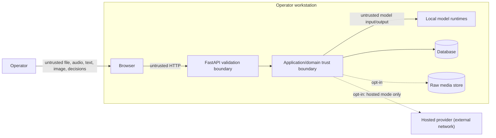

# Threat model

**Scope:** LabJarvis 0.1 local workstation deployment  
**Method:** asset/trust-boundary review with STRIDE-inspired abuse cases  
**Last reviewed:** 2026-09-28 (in-app configuration and supervised restart, named OpenAI/DeepSeek providers, local Kokoro voice; see T28–T31). Earlier: 2026-09-27 (per-stage OpenAI-compatible providers, hands-free listening and study mode; T20–T23); 2026-07-18 (hosted model execution; T17–T19)

## Security objective and boundary

Protect protocol integrity, session state, notebook/audit provenance, model inputs, participant privacy, and local availability while failing closed on untrusted uploads/model output. The supported deployment is one trusted operator on one workstation, bound to loopback. LabJarvis has no authentication or authorization and must not be exposed to other hosts.

The system is safety-adjacent but is not a safety control. Security controls prevent unauthorized or ambiguous software actions; they cannot validate scientific procedure, chemical compatibility, supervision, or physical contents.

## Assets

- Approved protocol versions and original source/hash.
- Current session/step state and pending confirmations.
- Notebook entries, correction lineage, inference metadata, verification decisions, audit events.
- Raw audio/images and transcripts when retention is enabled.
- Local database, optional PostgreSQL password, model cache, and environment configuration.
- Availability of the API/model processes during a lab session.
- Integrity and provenance of model/runtime dependencies.
- The hosted provider credential, when hosted mode is enabled.

## Trust boundaries

Even local input is untrusted: a protocol may be malicious, a transcript may contain prompt injection, a model may emit arbitrary output, and a stale browser tab may submit an old version.

The dashed edge to the hosted provider is the only path that leaves the
workstation, and it exists only when a stage is configured for a hosted
provider (in Settings or through `LABJARVIS_*` settings) **and** hosted
processing is allowed (`LABJARVIS_ALLOW_HOSTED_MODELS` / **Allow hosted
processing**), validated at startup. With every stage local that edge does not
exist at all — there is no code path that reaches a hosted provider, and no
fallback that could create one. Spoken replies are synthesised locally (Kokoro)
or by the browser, never by a hosted service.

## Threats, controls, and residual risk

| ID | Threat / abuse case | Implemented controls | Verification/evidence | Residual risk |
|---|---|---|---|---|
| T01 | Malformed PDF exploits parser or exhausts resources | exact MIME/suffix allowlist, file/page/character limits, encrypted/corrupt rejection, worker-thread extraction, no script/macro execution | document unit tests; malformed-upload API/E2E path | Third-party parser vulnerabilities; keep PyMuPDF patched and parse only locally |
| T02 | DOCX zip bomb, traversal, duplicate/unsafe archive entries | entry count and total uncompressed limits before `python-docx`; reject absolute, parent, duplicate, encrypted paths; require DOCX structure | archive abuse tests | CPU cost within allowed archive; limits may need measured tuning |
| T03 | Unsafe upload filename overwrites files | bytes are processed in memory; source filename is not used for paths; retained media uses SHA-256-generated names | media-store tests | Local disk exhaustion if retention is deliberately enabled without quotas |
| T04 | Oversized audio/image causes denial of service | streaming byte limits, allowed content types, inference timeout, semaphore/concurrency bound, capture duration bounds | API/model failure tests and browser capture tests | Model libraries may allocate heavily after accepting a valid bounded input |
| T05 | Protocol/transcript prompt injection changes rules | versioned system prompt; reviewed instruction and transcript are delimited as untrusted data; strict schema and closed intent allowlist; deterministic revalidation | adapter tests, unsupported/adversarial fixtures | Model can produce a plausible but wrong allowed intent; confidence, ambiguity, confirmation, and evaluation remain necessary |
| T06 | Arbitrary/invalid model output mutates state | Pydantic closed schema, field bounds, command canonicalizer, state/version checks; models have no repository capability | local-model/fake-model/domain/API tests | Semantic error inside valid schema; human decision is the final gate |
| T07 | Ambiguous compound command performs unintended action | multiple recognized actions return `UNSUPPORTED` with ambiguity; low confidence does not create a pending mutation | text fixtures and principal workflow tests | Language variations outside fixtures may evade detection; measure unsafe-action rate |
| T08 | Stale/double confirmation corrupts state | optimistic session/protocol versions; pending status; idempotency scope/key/request hash; atomic Unit of Work | concurrency/idempotency/integration tests | Multiple API processes with SQLite are unsupported |
| T09 | OCR false accept encourages wrong reagent | deterministic normalization/alias comparison; conservative match/uncertain thresholds; visible expected/observed text/score; explicit confirm/reject/correct | reagent boundary tests, mismatch E2E, evaluation false-accept metric | OCR/text similarity cannot prove bottle contents; operator must inspect the physical label and procedure |
| T10 | Sensitive content leaks in logs/errors | structured logs include method/path/status/duration/correlation/error code but no bodies; safe error metadata; transcript log regression test | API failure/log-privacy test | Debugging tools, browser traces, OS crash dumps, and model runtimes need separate handling |
| T11 | Excessive audio/image/transcript retention | raw media off by default; independent transcript setting; visible setup/readiness status; hashes retained; generated paths and restrictive best-effort permissions | settings/media/API tests | No automatic age-based purge; operator must delete retained data under the study plan |
| T12 | Cross-origin/host abuse | loopback bind; explicit CORS origins; **an Origin allowlist enforced on every state-changing method before routing**; TrustedHost allowlist rejects wildcard; CSP, nosniff, frame-deny/referrer and permissions policies | `tests/integration/test_origin_guard.py` asserts the database is unchanged after a hostile-origin upload; settings/contract tests; Compose loopback mapping | No auth/rate limit; any non-loopback exposure is outside supported boundary |
| T12a | Cross-origin *write* by a browser-simple request | CORS is a read control: a `multipart/form-data` POST with no custom header is sent without a preflight, so a hostile page could previously create a protocol (confirmed: `Origin: https://attacker.example` returned `201`). `api/origin_guard.py` now refuses any state-changing request whose `Origin` is not allowlisted, before a handler runs | `test_origin_guard.py`: hostile origin creates nothing across repeated attempts; trusted origin still works; preflight unchanged | Requests with **no** `Origin` are still accepted so local CLI use keeps working. That is sound only because the deployment is loopback-only and single-operator; a networked deployment needs real authentication and CSRF tokens |
| T13 | Dependency/model supply-chain compromise | exact lock files, CI audits, Dependabot, explicit model download, cache excluded from Git, documented source/licence/hash/digest capture | secret/dependency tasks and model manifest | Upstream model blobs/runtime binaries are still trusted; pin immutable revisions before final experiments |
| T14 | Secret or participant data committed | `.gitignore`, repository secret scanner including untracked/cache paths, no included raw study fixtures, contribution checklist | `scripts/scan_secrets.py` and Git review | Pattern scanners cannot recognize all sensitive scientific content; manual review required |
| T15 | Notebook history is silently rewritten | append-only correction rows with `supersedes_entry_id`; confirmations/verifications/audit stored separately; exports include lineage | provenance/repository/export tests | A user with filesystem/database access can tamper offline; cryptographic signing is not implemented |
| T16 | Service failure leaves misleading UI | readiness per adapter; stable Problem Details; failure paths do not mutate; typed/media fallback; visible status not color-only | API failure and Playwright failure tests | In-process crash interrupts a session; no HA or external watchdog is implemented |
| T17 | Laboratory data is sent to a third party without a deliberate decision | hosted processing is off by default; every hosted stage requires hosted processing to be allowed, a credential and an explicit model identifier, all validated at startup (and before a Settings choice is saved); changes apply only at restart, never mid-session; no automatic local-to-hosted fallback; setup and diagnostics state the boundary in plain language; nothing is transmitted before an operator-initiated action | settings validation tests, factory tests, hosted readiness/workflow integration tests, frontend warning tests | Provider-side retention, training, residency, and deletion are governed by the operator's account terms and cannot be enforced or observed by LabJarvis; institutional approval is the operator's responsibility |
| T18 | Hosted credential leaks through logs, responses, exports, or Git | key held as `SecretStr` and read only at request time; excluded from `repr`, validation errors, readiness, exceptions, and exports; provider error bodies are discarded rather than echoed; never accepted from the browser or stored in the database; `.env.example` carries no usable value; repository secret scanner | settings representation tests, hosted client sanitisation tests, readiness credential tests, frontend no-credential-field tests, `scripts/scan_secrets.py` | The operator's own shell history, environment dumps, process listings, and provider dashboard remain outside LabJarvis control |
| T19 | Hosted model output escapes validation because a provider shape differs | one shared strict command contract used by both the Ollama and hosted paths; provider `status` and every content part checked before parsing; any non-`output_text` part rejected; bounded response read before JSON decoding; label schema exposes only `visible_text` so no verification outcome can be returned by a model | command contract tests, hosted text/vision schema and refusal tests, oversized/malformed response tests | Provider response shapes change on the provider's schedule; a shape not covered by current documentation would fail closed rather than pass through, but would need a code update to support |
| T20 | A per-stage hosted provider receives data the operator did not expect (e.g. hybrid mode sends only text, but a misconfiguration also sends audio or images) | each stage has its own explicit provider, base URL, key and model; vision or speech on an OpenAI-compatible endpoint must be declared as a capability or startup fails; the header chips, Diagnostics -> Model stages and `/health/ready` show per stage the provider label and whether it is local or hosted; no automatic fallback between providers | settings capability tests, model-factory per-stage tests, readiness stage-provenance tests, `ModelStages` component tests | The provider label is operator-supplied text; LabJarvis cannot verify who operates an endpoint |
| T21 | Operator-supplied request extras (`LABJARVIS_HOSTED_TEXT_EXTRA_BODY`) override the prompt, schema or tools | extras must be a JSON object and may not contain `model`, `messages`, `tools`, `tool_choice`, `functions` or `stream`; every hosted answer is validated against the same command schema and entity grounding regardless of output mode | settings validation tests, OpenAI-compatible adapter contract tests (JSON mode, prompt-only, malformed and refused outputs) | A provider may ignore requested options such as disabling reasoning; that affects cost/latency, not validation |
| T22 | Always-on listening captures speech not addressed to the assistant | in-browser VAD is off unless enabled; audio is sent only after a detected utterance; the server discards utterances without the wake phrase before any inference or retention (`WAKE_PHRASE_ABSENT`); listening state is visible and announced | hands-free backend tests (no inference row, no retained media), `HandsFreeListeningPanel` tests | A wake phrase spoken in background conversation is still processed; confirmation remains the barrier |
| T24 | Voice-only mode commits a proposal the operator did not intend (a colleague's speech, a bare "yes", LabJarvis' own read-back, a second value) | opt-in; needs hands-free listening and the high-integrity cross-check; the reply must start with the wake phrase, restate exactly one value that matches the proposal (value+unit, duration, step number, action name, reagent name) and be agreed by both transcriptions; unaddressed speech is discarded before anything is written; spoken prompts never contain the wake phrase and prompt-like wording ("say ...") is refused; the browser drops segments that began during or within 1 s of LabJarvis speaking; observations and skips are never voice-only | `test_voice_only_confirmation.py`, `test_voice_confirmation.py`, `HandsFreeListeningPanel.test.tsx` echo guard, `voicePhrase.test.ts` | A person who deliberately says the value confirms it; confirmation quality is untested with participants |
| T25 | A stable but wrong label reading (e.g. a mismatching bottle) is recorded as verified | live stability only selects frames for the ordinary pending reading; the optional timed local single-frame check offers no cross-frame agreement; both still need an explicit review. A MISMATCH or UNCERTAIN reading can never be confirmed by voice; a confirmed MISMATCH counts as `not_matching`, never as a completed review | `test_live_label_scan.py`, `test_voice_only_confirmation.py`, `LiveScan.test.tsx`, `HandsFree.test.tsx` | OCR can still read a wrong label as the expected name (digit-for-letter); the human remains the check |
| T27 | A hosted vision-language model "reads" a defaced or look-alike label as the expected reagent | the reagent comparison stays deterministic and the result is only a proposal; EasyOCR remains the default; measured in D8a (provisional): `gpt-5.4-nano` 10 false accepts vs EasyOCR 6 on rendered labels, all misspelled decoys normalised to the expected word | `research/final_report_evidence/live/d8-vision.json` | hosted vision is supported but not recommended for label checks until measured on real photographs |
| T26 | Live scanning sends many frames to a hosted provider (privacy and cost) | repeated probes are refused unless Vision is local (loopback counts as local); hands-free with hosted Vision instead captures one cropped frame after a spoken countdown and sends it only on an explicit reagent-check request; the pending reading still needs confirmation | settings and hands-free capture tests | A hosted provider receives that image and may retry a failed request under its configured retry policy |
| T-HF1 | Listening for a whole session (no idle timeout) widens what is heard | opt-in (`LABJARVIS_HANDS_FREE_PROFILE` / `_AUTOSTART`); starts only after a visible one-tap gesture (or the documented localhost kiosk launch); visible and announced status; "Jarvis, stop listening" puts it in standby where only "start listening" is accepted and everything else is discarded untraced; re-starting by voice is honoured only while the tab has focus; the idle timeout still applies outside a session; unaddressed speech is still discarded before inference or retention | `HandsFreeLifecycle.test.tsx` (no idle timeout, standby), `test_hands_free_bench.py::test_standby_accepts_only_start_listening` (no inference row) | The microphone stays open in standby; a wake phrase in background talk is still transcribed (then confirmation remains the barrier) |
| T-HF2 | Barge-in lets LabJarvis' own speech (or the alarm) act | a segment that started during or within 1 s of LabJarvis speaking or sounding is sent only in `barge_in` mode, where the server honours stop/quiet, mute and stop-the-alarm and discards everything else without trace; prompts never contain the wake phrase; none of the three controls touches the record | `test_barge_in_accepts_only_stop_mute_and_the_alarm`, echo-guard tests, zero-touch E2E | An echo could at worst interrupt speech or silence an alarm - never propose, confirm or record |
| T-HF3 | A spoken correction or skip changes the record wrongly | both are proposals (ALWAYS policy); a correction restates the new value and unit, appends a linked `correction` entry, never edits the original, targets only the newest entry of the most recent (or named) measurement, and fails closed if that entry was corrected again meanwhile; a skip needs a spoken reason and restates "skip step N"; a reply naming another action never confirms | `test_hands_free_bench.py` safety matrix (valid / bare / wrong / second / unaddressed / echo / stale), `test_a_correction_overtaken_on_screen_fails_closed`, property suite | Only measurements can be corrected by voice; other fields need the screen |
| T-HF4 | A voice-confirmed observation records text the operator did not say | opt-in (`LABJARVIS_VOICE_OBSERVATIONS_ENABLED`, off by default); LabJarvis reads the text back first; "confirm observation" is accepted only when both transcriptions of the dictation agreed and the reply contains nothing else; documented as weaker than value read-back | `test_observations_are_voice_only_only_when_opted_in_and_both_readings_agree`, `test_a_typed_observation_cannot_be_confirmed_voice_only` | Two recognisers can agree on the same mishearing, and a hurried operator may confirm without listening |
| T-HF5 | The kiosk autoplay flag is abused | only passed by `scripts/tasks.py hands-free` to a dedicated browser profile opened on `http://127.0.0.1`; the page honours `?kiosk=1` only on a loopback host, checks that audio really runs without a gesture, shows a kiosk banner, and otherwise falls back to the one-tap prompt | zero-touch E2E kiosk test | The flag lets any page in that dedicated profile play audio; do not browse elsewhere in it |
| T-HF6 | An alarm is missed (muted speech, reload) | alarms are derived from server timer state on every read, so they survive a reload; the tone plays even when speech is muted; the alarm is text plus icon, not colour alone; repeated every 20 s until acknowledged | `test_a_finished_timer_alarms_until_acknowledged_and_survives_a_reload`, `timerAlarms` tests | A closed laptop lid or a muted OS output still silences the tone |
| T28 | The Settings or restart endpoint is abused to run commands, change configuration remotely or restart mid-session | `PUT /api/v1/settings` and `/restart` accept only loopback clients and pass the Origin guard; the saved schema forbids unknown fields and accepts only provider/model identifiers (no URLs, keys or paths); the restart body is a single consent flag; the API writes only a marker carrying the launcher's random token and stops along the graceful path; the launcher restarts only its fixed command and only on a matching token; an active session needs explicit consent; a saved choice that would not start is refused before restarting | `test_settings_api.py` (remote client refused, command/path/argument bodies rejected, consent, records intact), `test_restart_protocol.py` (token, stale request, fixed command) | A local process on the same account can still write the marker; that is inside the single-operator trust boundary |
| T29 | Configuration silently differs from what the operator sees (an inherited variable overriding `.env` or Settings, two OpenAI keys, dead `.env` lines) | per-variable precedence documented; the launcher prints inherited `LABJARVIS_*` names at startup; Settings shows each key's source and lists shadowing variables, duplicate OpenAI key names, overridden saved choices and ineffective `.env` lines; an invalid saved configuration stops startup with the reason instead of falling back | `test_settings_api.py` precedence and key-rotation tests, `test_saved_configuration.py`, launcher warning test | An operator can ignore a displayed warning |
| T30 | A key is sent to the wrong provider (for example a DeepSeek endpoint capturing OpenAI requests) | OpenAI and DeepSeek are separate named providers; `Settings.connection_for` always pairs each with its own endpoint and key; per-stage overrides apply only to the generic OpenAI-compatible provider | `test_saved_configuration.py::test_deepseek_and_openai_keep_separate_endpoints_and_keys`, Settings switching test | A generic OpenAI-compatible endpoint is operator-supplied and trusted as configured |
| T31 | The local voice is abused or its model is tampered with | the synthesis endpoint accepts only text (1-1000 characters) and a validated voice name, stores nothing and writes no record; one synthesis at a time; model files are fetched only by the explicit setup command and installed only if size and pinned SHA-256 match | `test_speech_output.py` (bounded body, tampered download rejected, serialised synthesis) | Upstream model content is trusted once its digest is pinned; the GPL-3.0 phonemizer/eSpeak NG components are installed from PyPI, not redistributed |
| T23 | Study mode's deliberately wrong proposals reach real work | study mode requires a script plus the literal acknowledgement phrase, is refused in production settings, shows a persistent STUDY MODE banner and labels every seeded proposal in provenance | study-mode settings and wrapper tests | Intended only for consented desk simulations with water and printed labels |

## Security assumptions

- The workstation account, browser, OS, and filesystem are trusted and patched.
- One operator uses the database at a time; local adversaries with account/filesystem access are out of scope.
- Laboratory policies determine whether any protocol or recording may be processed or retained.
- Models are acquired from documented upstream sources over a trusted connection and reviewed before use.
- The operator checks physical labels and follows supervision/SDS/risk assessments independently.
- In hosted mode, the operator has obtained any institutional approval required to send laboratory or participant data to a third party, and has verified retention, training, and residency terms against their own provider account. LabJarvis asserts none of these on the provider's behalf.

## Deployment hardening required beyond localhost

Do not only change `LABJARVIS_HOST`. A network deployment requires, at minimum: authenticated identity, authorization and session ownership, TLS, CSRF analysis, rate/body limits at a reverse proxy, secret vaulting, encrypted storage/backups, database roles, audit export protection, lifecycle deletion, monitoring/alerting, model service isolation, penetration testing, and an updated data-protection/ethics assessment.

## Review triggers

Revisit this model when adding a cloud adapter, authentication, multi-user access, autonomous tool calls, equipment control, automatic wake-word recording, new file types, new models, long-term raw retention, a public endpoint, or a real participant study.

